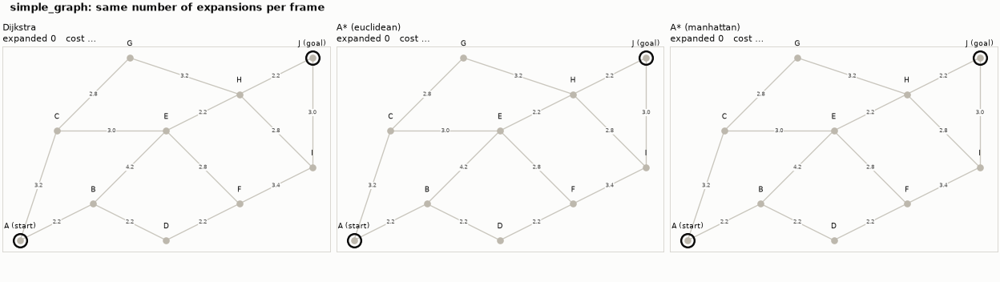

# A* Pathfinding Demo

A* implemented on two graph data structures, with simple/complex map generators, visual comparisons
against Dijkstra, several classic heuristics, and an interface for custom heuristics.

| Data structure | Module | Nodes | Edges |
|---|---|---|---|
| 2D matrix | [grid.py](src/astar/grid.py) `GridMap` + `astar_grid` | `(row, col)` | Implicit from indices (4/8-connected); cost = target cell cost (diagonal ×√2) |
| Vertex/edge | [graph.py](src/astar/graph.py) `Graph` + `astar_graph` | Any hashable id + `(x, y)` position | Stored explicitly in an adjacency list; directed/undirected; non-negative weights |

Dijkstra is simply A* with a heuristic that is always 0 (`heuristic="zero"`, or use `dijkstra_grid` / `dijkstra_graph`).

## Demo



From start A to goal J, each of the three algorithms expands one vertex per frame:

| Algorithm | Vertices expanded | Path cost | Notes |
|---|---|---|---|
| Dijkstra | 10 | 10.63 | Only looks at cost so far, so it even expands D and F, which lead away from the goal |
| A* (Euclidean) | 6 | 10.63 | Euclidean distance never overestimates, so the path is still optimal with fewer expansions |
| A* (Manhattan) | 5 | 11.39 | Overestimates on a planar graph: fewest expansions, but the path is 7.1% longer than optimal |

Legend: shades of blue show expansion order (lighter = expanded earlier), light-blue circles are vertices still in the open list, the orange line is the final path, and gray numbers are edge weights.

## Quick start

```bash
uv sync
uv run astar demo                 # Run all demos; PNG/GIF files go to output/ (~1 minute; --no-anim skips GIFs and takes a few seconds)
uv run astar heuristics           # List heuristics
```

`demo` prints each algorithm's path cost and expanded-node count for every map, and automatically verifies that:
① paths consist of legal moves and their cost matches the reported value; ② admissible heuristics yield the same cost as Dijkstra.

Generated files:

| File | Contents |
|---|---|
| `grid_simple.png/gif` | Simple map: 15×25 with a bracket-shaped wall between start and goal |
| `grid_open.png/gif` | Open field: Dijkstra expands 1185 cells, A* only the 44 on the path |
| `grid_maze.png/gif` | 41×61 maze (with loops) |
| `grid_random.png/gif` | 60×90 random rectangular obstacles, 8-connected |
| `grid_terrain.png/gif` | 60×90 weighted terrain (cost 1–9) with peaks and a river that has only two crossings |
| `graph_simple.png/gif` | 10-vertex road network with labeled edge weights, easy to check by hand; the animation expands one vertex per frame |
| `graph_road.png/gif` | 800-vertex random road network (with "lake" holes in the middle) |
| `benchmark.png` | Expanded nodes and path cost per heuristic across several maps |

Legend: shades of blue show expansion order (lighter = expanded earlier), light blue marks nodes still in the open list, the orange line is the final path, and S/G are the start and goal.
In the animations every algorithm expands the same number of nodes per frame, so you can see directly how much more focused A*'s search is.

### Running individually

```bash
# Matrix maps: --map simple|open|maze|random|terrain|file; repeat -H to compare side by side
uv run astar grid --map maze -H zero -H manhattan -H manhattan*2 --show
uv run astar grid --map terrain --seed 3 -H zero -H octile --animate --out output
uv run astar grid --map file --file my_map.txt --diagonal --show   # ASCII: . open  # wall  1-9 cost  S start  G goal

# Vertex/edge graphs: --map simple|road
uv run astar graph --map road --nodes 1500 -H zero -H euclidean --animate --out output
```

Without `--show` or `--out`, only the statistics are printed.

## Heuristics

Every heuristic has the signature `heuristic(current, goal) -> float`, where `current` and `goal` are coordinate tuples; matrices and graphs share them.

| Name | Formula | When admissible (guarantees optimality) |
|---|---|---|
| `zero` | 0 | Always (this is Dijkstra) |
| `manhattan` | \|dx\|+\|dy\| | 4-connected grids (exact lower bound); overestimates on 8-connected grids or planar graphs |
| `euclidean` | √(dx²+dy²) | Always, as long as edge weights ≥ Euclidean distance |
| `chebyshev` | max(\|dx\|,\|dy\|) | Always (conservative) |
| `octile` | max+(√2−1)·min | Exact lower bound for 8-connected grids with diagonal cost √2 |
| `name*w` | w·h | For w>1 this is Weighted A*: fewer expansions, cost ≤ w × optimal |

The built-in heuristics assume a minimum cell cost of 1; if the map has cells cheaper than 1, `astar_grid` automatically scales the heuristic down proportionally.

### Custom heuristics

```python
from astar import astar_grid, register_heuristic, maps

# Option 1: pass a callable directly
astar_grid(grid, heuristic=lambda current, goal: max(abs(current[0]-goal[0]), abs(current[1]-goal[1])))

# Option 2: register it under a name, then refer to it by string (including -H on the command line)
@register_heuristic("my_h", "description")
def my_h(current, goal): ...
```

On the command line, use `--plugin path/to/file.py` (registering with `@register_heuristic` inside the file) or `-H module:function` to refer to a custom function.
See [examples/custom_heuristic.py](examples/custom_heuristic.py) for a complete example:

```bash
uv run astar grid --map random --plugin examples/custom_heuristic.py -H zero -H tie_breaking_octile --show
PYTHONPATH=examples uv run astar grid --map maze -H zero -H custom_heuristic:manhattan_sq --show
```

When a heuristic is inconsistent (e.g. weighted or random), the implementation allows nodes to be reopened, so the returned path is still valid.

## Implementation notes

- The open list is a binary heap with entries `(f, h, insertion order, g, node)`. Ties in f are broken in favor of smaller h, which greatly reduces expansions in open areas.
- Lazy deletion: when a node's g value improves, a new entry is pushed; when popped, an entry whose g is larger than the current best g is skipped.
- No corner cutting with 8-connectivity: if either of the two orthogonally adjacent cells is a wall, the diagonal move is not allowed.
- `SearchResult` records `path`, `cost`, the expansion order `expanded`, the discovery order `discovered`, and the elapsed time; the visualizations are built from this data.

## Tests

```bash
uv run pytest
```

The tests compare A* against independently implemented reference algorithms: Bellman-Ford for matrix maps and Floyd-Warshall for vertex/edge graphs. They cover 4/8-connectivity, weighted terrain,
directed and undirected graphs, unreachable goals, corner cutting, and custom/weighted/inconsistent heuristics, and check that A* expands no more nodes than Dijkstra on the demo maps.

> If your system `PYTHONPATH` includes third-party pytest plugins (e.g. ROS), run `env -u PYTHONPATH uv run pytest`.
